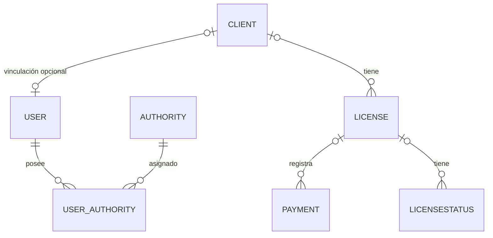

# Modelo de entidad–relación de DySI Client Manager

El modelo tiene **6 entidades principales**. El eje del negocio es **Cliente → Licencia → Pagos y estados de licencia**, mientras que usuarios y roles gestionan el acceso.

Este resumen refleja los mapeos JPA del código local revisado el **26 de octubre de 2026**, incluidos los cambios pendientes en ese momento. No verifica las restricciones reales de una base MySQL desplegada.

## Diagrama

El diagrama muestra las asociaciones principales. Los extremos opcionales reflejan que los mapeos no declaran esas referencias como obligatorias; los flujos de negocio pueden exigirlas. Para simplificar, se omiten las relaciones de auditoría hacia `USER`.

## Entidades

| Entidad / tabla | Qué representa | Datos principales |
| --- | --- | --- |
| **Client / CLIENT** | Cliente que posee licencias | Nombre, apellido, correo, teléfono y CUIL/CUIT |
| **License / LICENSE** | Licencia de una empresa vinculada a un cliente | Descripción, empresa, `companyId`, inicio de actividad y pago adelantado |
| **LicenseStatus / LICENSESTATUS** | Condiciones de vigencia y bloqueo de una licencia | Fecha de bloqueo, bloqueo forzado, límite de transacciones y observaciones |
| **Payment / PAYMENT** | Pago asociado a una licencia | Importe, descuento, fechas de pago, cobro y vencimiento, y observaciones |
| **User / USER** | Cuenta de acceso al sistema | Usuario único, hash de contraseña, datos personales, habilitación y último cambio de contraseña |
| **Authority / AUTHORITY** | Rol de autorización | `ROLE_ADMIN`, `ROLE_USER` o `ROLE_SELLER` |

Todas las entidades tienen un identificador `id` de tipo `Long`. `USER_AUTHORITY` es una tabla de asociación, sin clase de entidad propia en este modelo.

## Relaciones

- **Cliente–Usuario: uno a uno opcional.** Un cliente puede estar vinculado a una cuenta. Actualmente ambas entidades declaran su propia referencia `@OneToOne`, sin `mappedBy`; el servicio debe mantenerlas sincronizadas.
- **Cliente–Licencia: uno a muchos.** Un cliente puede tener varias licencias; cada licencia referencia un cliente. `License.client` es el lado propietario de la asociación y `Client.licenses` utiliza `mappedBy`.
- **Licencia–Pago: uno a muchos.** Cada pago corresponde a una licencia. `Payment.license` es el lado propietario y `License.paymentList` utiliza `mappedBy`.
- **Licencia–Estado: uno a muchos.** El modelo permite varios registros de estado por licencia. `LicenseStatus.license` es el lado propietario y `License.licenseStatuses` utiliza `mappedBy`. El flujo web selecciona el estado no eliminado de menor ID y crea uno al guardar una licencia sin estado.
- **Usuario–Rol: muchos a muchos.** La tabla intermedia **`USER_AUTHORITY`** contiene `USER_ID` y `AUTHORITY_ID`. `User.authorities` define la tabla de asociación y `Authority.users` utiliza `mappedBy`.

## Auditoría compartida

**Client, License, LicenseStatus, Payment y User heredan de `AuditableEntity`**, que aporta:

| Evento | Fecha | Usuario responsable |
| --- | --- | --- |
| Creación | `creationDate` | `createdBy` |
| Modificación | `modificationDate` | `modifiedBy` |
| Anulación lógica | `removeDate` | `removedBy` |

Los tres responsables son referencias opcionales `ManyToOne` a `User`. Un usuario puede figurar como actor en muchos registros, incluidos otros usuarios o su propio registro. Los actores históricos desconocidos o las operaciones sin autenticación pueden quedar sin usuario asociado.

`AuditableEntity` es una superclase mapeada (`@MappedSuperclass`): **no tiene tabla propia**; sus columnas se incorporan a cada tabla que la hereda. `Authority` no hereda de esta clase.

La anulación lógica conserva el registro. Repetirla preserva su primer evento; la reactivación limpia fecha y actor de anulación. Esta auditoría no constituye un historial completo de versiones.

## Particularidades y límites

- **`License.companyId` identifica a la empresa** y es distinto del ID de cliente y del ID interno de licencia. No representa una relación JPA con otra entidad del proyecto.
- Las colecciones de pagos y estados de `License` tienen `cascade = ALL` y `orphanRemoval = true`. Una eliminación física o la remoción de elementos de esas colecciones puede eliminar registros relacionados; es un comportamiento diferente de la anulación lógica.
- Los importes y descuentos de `Payment` se persisten como `Double`, aunque el contrato web utiliza `BigDecimal`. El modelo persistente no garantiza precisión decimal exacta.
- Registrar o cobrar un pago no extiende automáticamente la vigencia de la licencia.
- El modelo no contiene entidades de facturas, ledger, saldo a favor ni conciliación.

## Fuentes del resumen

Clases bajo `src/main/java/com/dysi/AngryBoxClientManager/models/`:

- `Client.java`
- `License.java`
- `LicenseStatus.java`
- `Payment.java`
- `User.java`
- `Authority.java`
- `AuthorityName.java`
- `AuditableEntity.java`
